# Sift: App Review Intelligence

Sift turns what users write in app reviews into a ranked product backlog. Search any App Store app (or import a CSV from Google Play Console) and Sift does the rest:
- reads up to 300 recent reviews;
- classifies every review by sentiment, category and severity;
- groups complaints into themes;
- ranks what to fix or build next, with evidence;
- drafts developer replies;
- researches competitors on the web.

<p>
  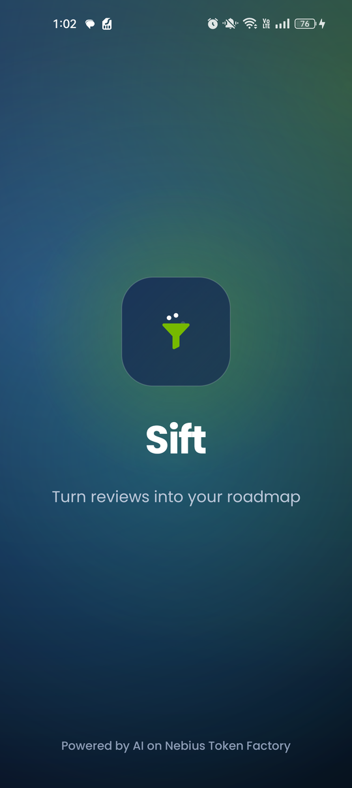
  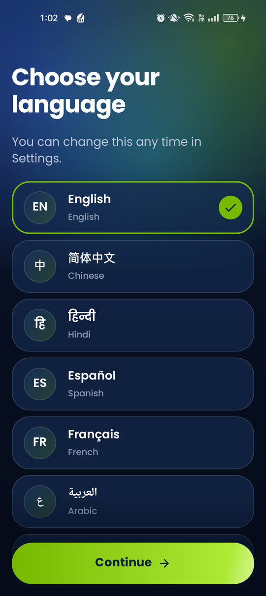
  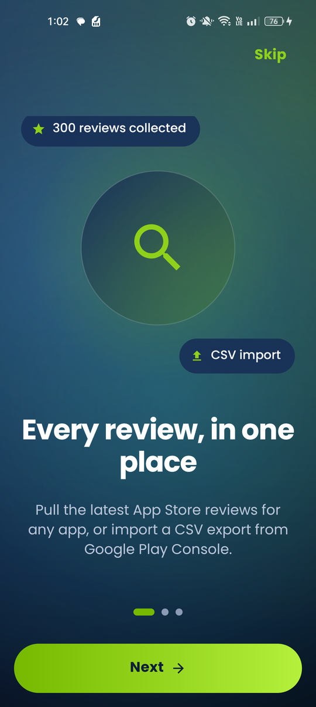
  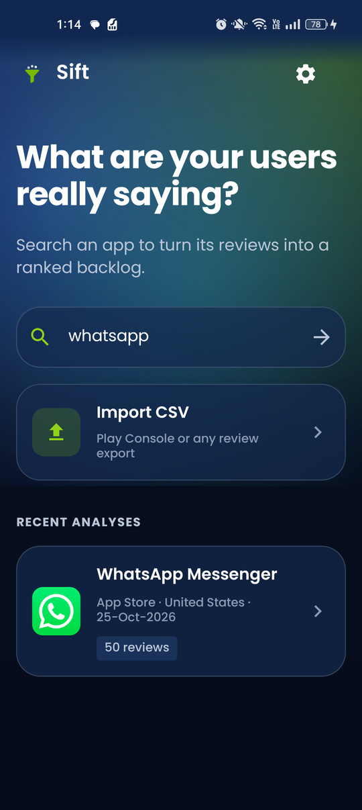
  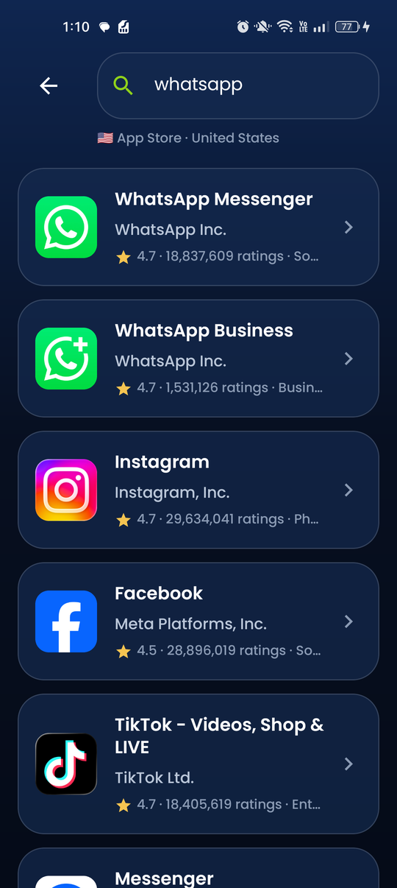
</p>
<p>
  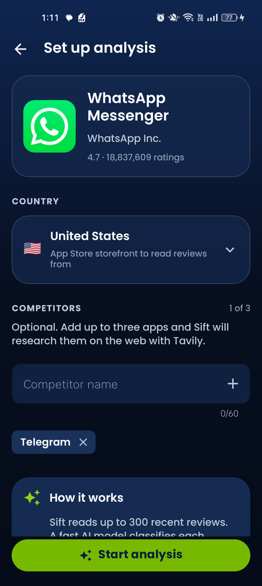
  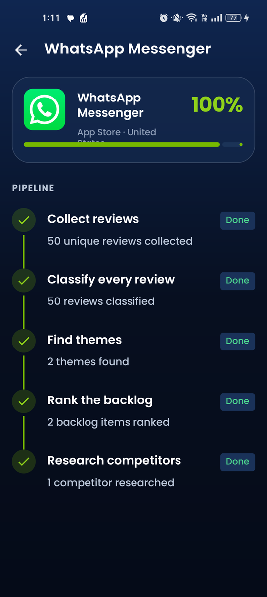
  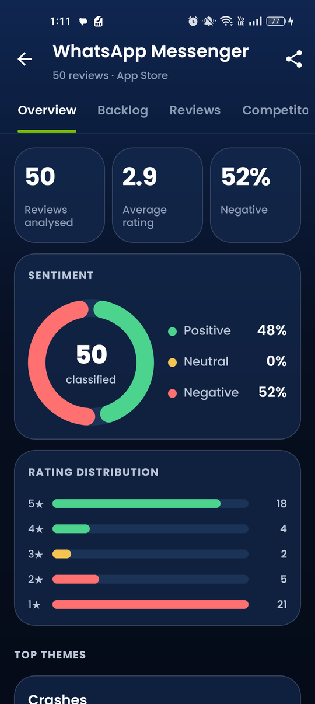
  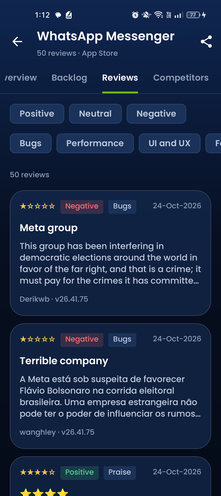
  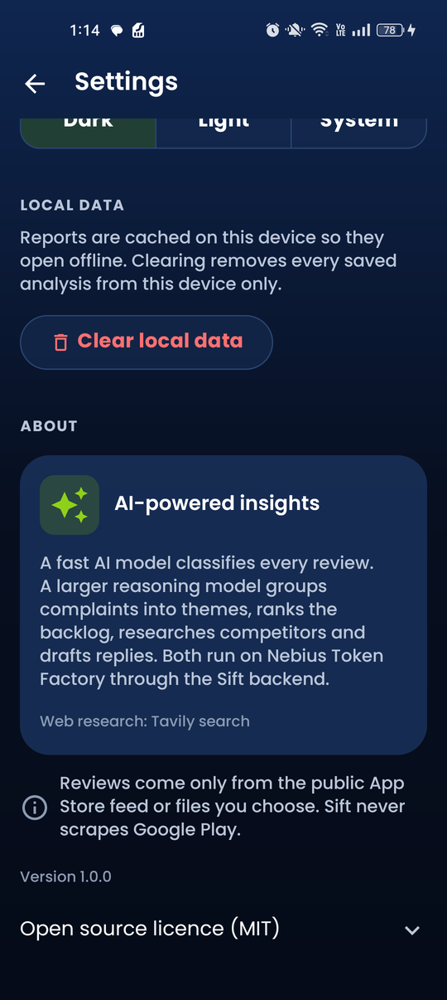
</p>

The report screenshots come from a QA run with real App Store reviews; see [docs/QA_REPORT.md](docs/QA_REPORT.md).

## Features

- **Search any App Store app** in any country, or **import a CSV** (Play Console export or any file with a review text column).
- **Live progress timeline** while the backend works through five steps: collect, classify, find themes, rank, research competitors.
- **Report with four tabs:**
  - Overview: metrics, sentiment chart, rating distribution, top themes with quotes.
  - Backlog: ranked items with priority, effort and evidence, plus "Copy as ticket" in Markdown.
  - Reviews: filters and AI reply drafts in three tones.
  - Competitors: web-researched strengths, weaknesses and opportunities, with sources.
- **Share** the whole report as a Markdown file.
- **Works offline** for reports you have opened (cached in Room).
- **15 languages** with a full right-to-left layout for Arabic and Urdu:
  - English, Simplified Chinese, Hindi, Spanish, French, Arabic, Bengali, Portuguese;
  - Russian, Urdu, Indonesian, German, Japanese, Swahili, Turkish.
- **Polished, accessible UI:**
  - Poppins type, dark and light themes, glass cards;
  - animated logo, ambient glows, spring button feedback, haptics;
  - charts that draw in;
  - content descriptions throughout, and every animation turns off with the system "Remove animations" setting.
- **Onboarding** on first launch: animated splash, language picker, three welcome pages, and a Sift Pro preview (no billing, nothing is charged).

## How it works

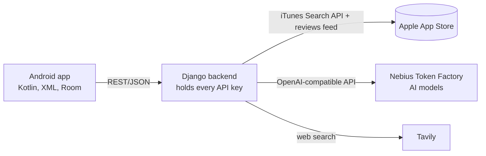

The app never holds API keys: every AI call goes through the backend.

| Step | Where | What happens |
|---|---|---|
| Collect | backend | App Store reviews from Apple's public feed (up to 300), or the uploaded CSV, de-duplicated |
| Classify | backend, fast model | Sentiment, category, severity and a one-line summary for every review, in batches, in any language |
| Find themes | backend, reasoning model | Groups complaints into themes with representative quotes |
| Rank | backend, reasoning model | A prioritised backlog with reasoning, user impact, suggested fix, effort and evidence |
| Research | backend, reasoning model + Tavily | Tool-calling loop that searches the web for each competitor and summarises it with sources |
| Reply | backend, reasoning model | On-demand public developer reply in the chosen tone |

The models run on **Nebius Token Factory** through its OpenAI-compatible API. The defaults in `backend/.env.example` are NVIDIA Nemotron models: `nvidia/NVIDIA-Nemotron-Nano-9B-v2` for fast classification and `nvidia/Llama-3_3-Nemotron-Super-49B-v1_5` for reasoning. Any compatible model ids can be configured there.

### Android architecture

Clean Architecture in a single module:
- **domain:** models, repository interfaces and use cases in pure Kotlin.
- **data:** Retrofit, Room and the per-app language setting.
- **presentation:**
  - one activity hosting fragments through a small `Navigator`, with no Navigation component;
  - XML layouts with ViewBinding, no Compose;
  - ViewModels each exposing one `StateFlow<UiState>`.

Dependencies are wired by hand in `di/AppContainer`.

## Quick start

### 1. Backend (Windows)

```bash
cd backend
python -m venv .venv
.venv\Scripts\pip install -r requirements.txt
copy .env.example .env      # then set NEBIUS_API_KEY and TAVILY_API_KEY
.venv\Scripts\python manage.py migrate
.venv\Scripts\python manage.py runserver 0.0.0.0:8000
```

In VS Code you can instead open the repo and run **Terminal → Run Task… → Run Sift backend** (defined in `.vscode/tasks.json`).

Check it at <http://localhost:8000/api/v1/health/>; it also reports whether the keys are configured. App Store search works without keys. Analyses need `NEBIUS_API_KEY`, and competitor research needs `TAVILY_API_KEY`.

### 2. Android app

1. Connect a phone with USB debugging (or start an emulator), then forward the port:
   ```bash
   adb reverse tcp:8000 tcp:8000
   ```
2. Install the ready-made APK:
   ```bash
   adb install dist/Sift-debug.apk
   ```
   Or build it from source:
   ```bash
   cd android
   gradlew installDebug
   ```

The app talks to `http://localhost:8000/` by default. To point a build somewhere else, use `-Psift.backendUrl=...` or edit `android/gradle.properties`:

| Setup | Backend URL |
|---|---|
| Phone or emulator with `adb reverse tcp:8000 tcp:8000` | `http://localhost:8000/` (default) |
| Emulator without adb reverse | `http://10.0.2.2:8000/` |
| Phone on the same Wi-Fi as the PC | `http://<PC LAN IP>:8000/` (debug builds allow cleartext; open port 8000 in the firewall) |
| Hosted backend | `https://your-server/` |

**Step-by-step usage:** [docs/USER_GUIDE.md](docs/USER_GUIDE.md).

## Configuration (`backend/.env`)

| Variable | Purpose |
|---|---|
| `NEBIUS_API_KEY` | Nebius Token Factory key (required for analyses and replies) |
| `NEBIUS_BASE_URL` | Token Factory OpenAI-compatible endpoint |
| `MODEL_FAST` / `MODEL_REASONING` | Model ids for classification and for themes, backlog, research and replies |
| `TAVILY_API_KEY` | Tavily web search key (competitor research) |
| `DJANGO_SECRET_KEY`, `DEBUG`, `ALLOWED_HOSTS` | Django settings |
| `LLM_TIMEOUT_SECONDS`, `SQLITE_PATH`, `CORS_ALLOWED_ORIGINS` | Optional tuning |

`backend/.env` is git-ignored. Never commit real keys.

## Tests and quality

```bash
cd android && gradlew testDebugUnitTest lintDebug assembleRelease
cd backend && .venv\Scripts\python manage.py test analyses
```

- Android: 34 unit tests; lint reports 0 errors; the minified release build passes.
- Backend: 54 tests.
- Full device QA results: [docs/QA_REPORT.md](docs/QA_REPORT.md).

## Translations

The 15 languages are generated from the tables in `tools/i18n`:

```bash
cd tools/i18n
python -I gen.py de fr es pt ru tr id_ sw hi bn ar ur zh ja
```

The generator escapes text for Android, fails on any missing key and checks that every placeholder matches English. Brand names (Sift, Nebius Token Factory, Tavily) stay untranslated.

## Project structure

```
android/            Android app (Kotlin)
  app/src/main/java/com/sift/app/
    domain/         models, repository interfaces, use cases
    data/           Retrofit API, Room cache, settings, language
    presentation/   fragments, ViewModels, custom views, onboarding
    di/             AppContainer
  third_party/      Poppins font licence (OFL)
backend/            Django REST backend
  analyses/services/  pipeline: sources, classify, insights, competitors, replies
docs/               user guide, QA report, screenshots
dist/               Sift-debug.apk
test-data/          sample_reviews.csv (fictional reviews for the CSV import)
tools/              resource checks and the translation generator
```

## Limitations

- **Review coverage:** Apple's public review feed is inconsistent. Some apps currently return no reviews and others one page (about 50). Sift then shows "No reviews yet" or analyses what was returned. CSV import always works.
- **Sift Pro** is a preview with no billing.
- **APK:** the committed APK is a debug build. Sign a release build with your own key.

## Licence

MIT, see [LICENSE](LICENSE). Poppins is licensed under the SIL Open Font License 1.1 (`android/third_party/poppins/OFL.txt`).
