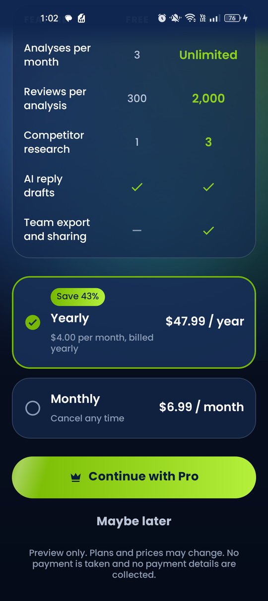
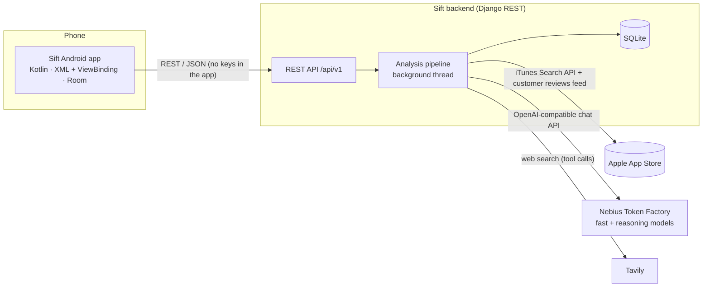

# Sift: App Review Intelligence

**Sift turns what users write in app reviews into a ranked product backlog.**

Search any App Store app, or import a CSV of reviews from Google Play Console. Sift then:
- reads up to 300 recent reviews;
- classifies each one;
- groups complaints into themes;
- ranks what to fix or build next, with evidence;
- drafts replies to reviewers;
- researches competitors on the web.

Sift has two parts:
- an Android app (Kotlin, XML layouts, 15 languages);
- a small Django backend that holds every API key and runs the AI models on **Nebius Token Factory**, with **Tavily** for web research.

<p>
  
  
  
  
  
</p>
<p>
  
  
  
  
  
</p>

**Documents:**
- [Judges' guide (5 minutes)](docs/JUDGES_GUIDE.md)
- [User guide](docs/USER_GUIDE.md)
- [QA report](docs/QA_REPORT.md)
- [Demo video script](docs/VIDEO_SCRIPT.md)
- Demo video: `docs/demo.mp4` (when present)
- Ready-made APK: [`dist/Sift-debug.apk`](dist/Sift-debug.apk)

---

## The problem

Popular apps get hundreds of reviews a week, in many languages. Product teams know the answers are in there, but nobody has time to read them all. They end up with:
- a gut feeling instead of a priority list;
- bugs found late, after the rating has already dropped;
- unanswered reviewers;
- competitors' strengths noticed by accident.

**Sift does the reading.** In one to three minutes it turns raw reviews into a ranked backlog. Every item links back to the reviews that justify it, so the team can act on evidence, not guesses.

## Features

- **Search any App Store app** by name, in any App Store country.
- **Import a CSV:** a Google Play Console export or any file with a review text column. Rating and date columns are detected automatically.
- **Live progress timeline** while the backend works: collect → classify → themes → backlog → competitors.
- **A report with four tabs:**
  - **Overview:** review count, average rating, share of negative reviews, an animated sentiment donut, rating bars and the top themes with quotes.
  - **Backlog:**
    - ranked items with a 0–100 priority, type (bug or feature) and effort;
    - each item explains why it ranks there, its user impact and a suggested fix, with evidence;
    - **Copy as ticket** copies an item as Markdown for Jira, Linear or GitHub.
  - **Reviews:** filter by sentiment and category; draft a reply in three tones (Friendly, Formal, Apologetic).
  - **Competitors:** strengths, weaknesses and opportunities researched on the web, with source links.
- **Share** a whole report as a Markdown file.
- **Offline:** reports you have opened are cached in Room.
- **15 languages**, with a full right-to-left layout for Arabic and Urdu:
  - English, Simplified Chinese, Hindi, Spanish, French, Arabic, Bengali, Portuguese;
  - Russian, Urdu, Indonesian, German, Japanese, Swahili, Turkish.
- **Onboarding:** an animated splash, a language picker, three welcome pages and a Sift Pro preview. The preview is a preview only: there is no billing and no payment details are asked for.
- **Polished, accessible UI:**
  - Poppins type, dark and light themes, glass cards;
  - an animated logo, ambient glows, spring feedback on buttons, haptics;
  - charts that draw in;
  - content descriptions and headings throughout;
  - every animation turns off with the system "Remove animations" setting.

## Architecture



- **The app never holds an API key.** All AI and search calls go through the backend, which reads keys from `backend/.env`.
- **Android:** Clean Architecture in a single module.
  - `domain`: models, repository interfaces and use cases in pure Kotlin.
  - `data`: Retrofit, Room and the per-app language setting.
  - `presentation`:
    - one Activity hosting fragments through a small `Navigator`, with no Navigation component and no Compose;
    - ViewModels that each expose one `StateFlow<UiState>`.
  - Dependencies are wired by hand in `di/AppContainer`.
- **Backend:**
  - Django REST Framework with SQLite.
  - Each analysis runs in a background thread. The app polls `GET /analyses/{id}/` to show live progress.

## The AI pipeline, step by step

| # | Step | Model | What happens |
|---|---|---|---|
| 1 | **Collect** | none | Apple's public reviews feed (most recent first, up to 300) or the uploaded CSV. De-duplicated and stored. **No AI key is needed for this step.** |
| 2 | **Check configuration** | none | If `NEBIUS_API_KEY` or a model id is missing, the analysis stops with a clear message: *"The server's AI key is not configured, so this analysis cannot run…"*. The reviews collected in step 1 are kept. |
| 3 | **Classify** | fast (`MODEL_FAST`) | Reviews in batches. Each gets a sentiment, a category (bug, feature request, UX, performance, pricing, praise…), a severity and a one-line summary. Works in any language. Output is strict JSON and validated. |
| 4 | **Find themes** | reasoning (`MODEL_REASONING`) | Groups complaints and requests into themes, each with a count and representative quotes. |
| 5 | **Rank the backlog** | reasoning | A prioritised list: title, type, priority 0–100, reasoning, user impact, suggested fix, effort and the supporting review ids. |
| 6 | **Research competitors** | reasoning + Tavily | A tool-calling loop. The model asks for web searches, the backend runs them on Tavily and returns the results, and the model writes strengths, weaknesses and opportunities with source URLs. This step is skipped if no competitors were added. |
| 7 | **Reply drafts** (on demand) | reasoning | `POST /reviews/{id}/reply/` drafts a public reply to one review in the chosen tone. |

Statistics in the report (counts, average rating, sentiment split, rating distribution) are computed from the stored data, not written by the model.

### How Nebius Token Factory is used

- The backend talks to Token Factory through its **OpenAI-compatible API** at `NEBIUS_BASE_URL`, using the official `openai` Python SDK.
- Two model roles keep it fast and cheap:
  - **`MODEL_FAST`** handles the high-volume classification.
  - **`MODEL_REASONING`** handles themes, ranking, competitor research and replies.
- The defaults in `backend/.env.example` are NVIDIA Nemotron models served on Token Factory:
  - `nvidia/NVIDIA-Nemotron-Nano-9B-v2` (fast);
  - `nvidia/Llama-3_3-Nemotron-Super-49B-v1_5` (reasoning).
- Any model id from the Token Factory catalog that supports chat (and tool calling, for the reasoning model) can be used.
- Responses are requested as JSON and validated, with retries and a timeout (`LLM_TIMEOUT_SECONDS`).

### How Tavily is used

- Tavily is the web search tool the reasoning model calls during competitor research.
- The backend exposes one `tavily_search` tool to the model, runs each requested query against Tavily and feeds the results back.
- The final competitor summary keeps the source URLs, which the app shows as links.
- Tavily is only used when competitors are added, and it needs the AI model as well.

## Tech stack

| Layer | Technology |
|---|---|
| Android | Kotlin, XML layouts + ViewBinding, ConstraintLayout, Material Components, Coroutines + StateFlow, Retrofit + OkHttp + Gson, Room, Coil, AppCompat per-app locales, SplashScreen API, ViewPager2 |
| Design | Poppins (SIL OFL), animated vector logo, custom views (aurora background, button shine, page indicator, charts) |
| Backend | Python 3, Django, Django REST Framework, SQLite, `openai` SDK, `tavily-python`, `jsonschema` |
| AI | Nebius Token Factory (OpenAI-compatible), with the NVIDIA Nemotron model family by default |
| Search | Tavily web search API |
| Data source | Apple iTunes Search API and the public customer reviews feed; CSV upload |

## Quick start

### What you need to provide

| What | Where to get it | Needed for |
|---|---|---|
| `NEBIUS_API_KEY` | Create an API key at **<https://tokenfactory.nebius.com>** (sign in → API keys) | Every AI step: classification, themes, backlog, competitor research, reply drafts |
| `MODEL_FAST` | A model id from the Token Factory catalog (default `nvidia/NVIDIA-Nemotron-Nano-9B-v2`) | Classification |
| `MODEL_REASONING` | A model id from the Token Factory catalog (default `nvidia/Llama-3_3-Nemotron-Super-49B-v1_5`) | Themes, backlog, research, replies |
| `TAVILY_API_KEY` | Create a key at <https://tavily.com> | Competitor research |

Without any keys you can still:
- go through onboarding, languages and Settings;
- search the App Store;
- collect reviews and see them counted.

Analyses then stop with the clear "AI key is not configured" message. See [docs/JUDGES_GUIDE.md](docs/JUDGES_GUIDE.md).

### 1. Backend (Windows, Python 3.11+)

```bat
cd backend
python -m venv .venv
.venv\Scripts\pip install -r requirements.txt
copy .env.example .env
```

Open `backend\.env` in a text editor and set `NEBIUS_API_KEY`, `TAVILY_API_KEY` and, if you like, `MODEL_FAST` and `MODEL_REASONING`. Then:

```bat
.venv\Scripts\python manage.py migrate
.venv\Scripts\python manage.py runserver 0.0.0.0:8000
```

On macOS or Linux, use `.venv/bin/...` and `cp` instead of `copy`. In VS Code you can instead run **Terminal → Run Task… → Run Sift backend** (defined in `.vscode/tasks.json`).

Check it at <http://localhost:8000/api/v1/health/>:

```json
{"status":"ok","version":"1.0.0","models":{...},"configured":{"nebius":true,"tavily":true}}
```

`configured` shows which keys the server has, without revealing them. Restart the server after editing `.env`.

### 2. Android app

1. Turn on USB debugging on the phone and connect it (or start an emulator). Then forward the backend port:
   ```bash
   adb reverse tcp:8000 tcp:8000
   ```
   Run this again whenever the phone reconnects.
2. Install the ready-made APK:
   ```bash
   adb install -r dist/Sift-debug.apk
   ```
   Or build from source (JDK 17):
   ```bash
   cd android
   gradlew installDebug
   ```
   Or open `android/` in Android Studio and press **Run 'app'**.
3. Open Sift on the phone. The phone also needs its own internet connection: the app checks that it is online before calling the server.

The app talks to `http://localhost:8000/` by default. To use another address, build with `-Psift.backendUrl=...` or edit `android/gradle.properties`:

| Setup | Backend URL |
|---|---|
| Phone or emulator with `adb reverse tcp:8000 tcp:8000` | `http://localhost:8000/` (default) |
| Emulator without adb reverse | `http://10.0.2.2:8000/` |
| Phone on the same Wi-Fi as the PC | `http://<PC LAN IP>:8000/` (debug builds allow cleartext; open port 8000 in the firewall and add the IP to `ALLOWED_HOSTS`) |
| Hosted backend | `https://your-server/` |

### Docker (optional)

```bash
cd backend
docker build -t sift-backend .
docker run --env-file .env -p 8000:8000 sift-backend
```

## Configuration (`backend/.env`)

| Variable | Required | Default | Purpose |
|---|---|---|---|
| `NEBIUS_API_KEY` | for AI | none | Nebius Token Factory API key |
| `NEBIUS_BASE_URL` | no | `https://api.tokenfactory.nebius.com/v1/` | Token Factory OpenAI-compatible endpoint |
| `MODEL_FAST` | for AI | `nvidia/NVIDIA-Nemotron-Nano-9B-v2` | Model id for classification |
| `MODEL_REASONING` | for AI | `nvidia/Llama-3_3-Nemotron-Super-49B-v1_5` | Model id for themes, backlog, research and replies |
| `TAVILY_API_KEY` | for competitors | none | Tavily web search key |
| `DJANGO_SECRET_KEY` | yes in production | none | Django secret key: use a long random string |
| `DEBUG` | no | `False` | Django debug mode |
| `ALLOWED_HOSTS` | no | `localhost,127.0.0.1,10.0.2.2` | Host names the server answers to |
| `CORS_ALLOWED_ORIGINS` | no | empty | Comma-separated origins for browser clients |
| `SQLITE_PATH` | no | `backend/db.sqlite3` | Database location |
| `LLM_TIMEOUT_SECONDS` | no | `90` | Timeout for a single model call |

`backend/.env` is listed in `.gitignore`. Never commit real keys. The Android app contains no keys.

## API reference

Base URL: `/api/v1/`. All responses are JSON. Errors look like `{"detail": "..."}`, or field errors such as `{"q": ["..."]}`.

| Method | Path | Purpose |
|---|---|---|
| GET | `health/` | Status, configured model ids and which keys are set (`configured.nebius`, `configured.tavily`) |
| GET | `apps/search/?q=whatsapp&country=us` | Search the App Store. Returns `results[]` with `app_id`, `name`, `developer`, `icon_url`, `rating`, `rating_count`, `genre`. |
| POST | `analyses/` | Start an analysis (`201`, background run). App Store: JSON `{"source":"appstore","app_id":"310633997","country":"us","competitors":["Telegram"]}`. CSV: multipart with `source=csv`, `file`, optional `app_name` and `competitors`. |
| GET | `analyses/{id}/` | Status (`pending`, `running`, `completed`, `failed`), current step, progress %, error message and summary statistics |
| GET | `analyses/{id}/reviews/?sentiment=negative&category=bug&page=1` | Paginated classified reviews |
| GET | `analyses/{id}/themes/` | Themes with counts and quotes |
| GET | `analyses/{id}/backlog/` | Ranked backlog items with evidence |
| GET | `analyses/{id}/competitors/` | Competitor insights with sources |
| GET | `analyses/{id}/export/` | The whole report as Markdown |
| POST | `reviews/{id}/reply/` | `{"tone":"friendly" \| "formal" \| "apologetic"}` returns a reply draft. Returns `503` with a clear message if the AI key is missing. |

Creating analyses and reply drafts is rate-limited per client.

## Testing and QA

```bash
cd android
gradlew testDebugUnitTest lintDebug assembleDebug

cd backend
.venv\Scripts\python manage.py test analyses
```

- **Android:** unit tests for use cases, domain rules and mappers; lint with 0 errors; debug and minified release builds.
- **Backend:** tests cover the API, CSV parsing, the Apple feed parser, the pipeline with a scripted model, competitor tool calling, and the missing-key path. That path keeps the collected reviews and fails with a clear message.
- **On a real phone** (OPPO CPH2333, Android 13), the full flow was checked end to end: onboarding, 15 languages including RTL, search, setup, progress, the four report tabs, sharing, CSV import, Settings, errors and process death.
- Full results and known gaps: [docs/QA_REPORT.md](docs/QA_REPORT.md).

## Project structure

```
android/                     Android app (Kotlin)
  app/src/main/java/com/sift/app/
    domain/                  models, repository interfaces, use cases
    data/                    Retrofit API, Room cache, settings, language
    presentation/            fragments, ViewModels, custom views, onboarding
    di/                      AppContainer (manual dependency wiring)
  app/src/main/res/          layouts, 15 translations (values-xx), fonts, animations
  third_party/               Poppins font licence (OFL)
backend/                     Django REST backend
  analyses/
    services/
      sources/               App Store search + reviews feed, CSV parser
      llm.py                 OpenAI-compatible client for Nebius Token Factory
      pipeline.py            collect → classify → themes → backlog → competitors
      competitors.py         Tavily tool-calling research
      replies.py             reply drafts
    tests/                   backend tests (scripted model and search fakes)
  config/                    Django settings and URLs
  .env.example               configuration template (copy to .env)
docs/                        judges' guide, user guide, QA report, video script, screenshots
dist/Sift-debug.apk          ready-to-install debug build
test-data/sample_reviews.csv fictional reviews for the CSV import
tools/                       translation generator and resource checks
```

## Translations

All 15 languages are generated from the tables in `tools/i18n`:

```bash
cd tools/i18n
python -I gen.py de fr es pt ru tr id_ sw hi bn ar ur zh ja
```

The generator escapes text for Android, fails on any missing key and checks that every placeholder matches English. Brand names (Sift, Nebius Token Factory, Tavily) stay untranslated.

## Limitations

- **Apple's review feed has gaps.** Apple's public feed is inconsistent: some apps (for example Notion in the US) currently return no reviews, others one page of about 50. Sift then shows "No reviews yet" or analyses what was returned. CSV import always works.
- **No Google Play scraping.** Sift deliberately does not scrape Google Play. Play reviews come in through a CSV export from Play Console.
- **AI needs a Nebius key.** Without `NEBIUS_API_KEY`, analyses collect reviews and then stop with a clear message. There is no offline or demo mode, and no other AI provider is used.
- **Sift Pro is a preview.** There is no billing; prices are shown for illustration only.
- **Debug APK.** The committed APK is a debug build. Sign a release build with your own key.
- **Single-server design.** Analyses run in a background thread with SQLite, which is fine for a demo or a small team. A task queue (Celery or RQ) and Postgres are the next step for scale.

## Roadmap

- Google Play reviews through the official Play Developer API (for app owners).
- Scheduled re-analysis with trend lines and alerts when a new theme spikes.
- One-click export of backlog items to Jira, Linear and GitHub Issues.
- Posting approved replies through the App Store Connect and Play APIs.
- Sift Pro with real billing, team workspaces and larger review limits.
- A task queue and Postgres for hosted, multi-user deployments.

## Licence

MIT, see [LICENSE](LICENSE). Poppins is licensed under the SIL Open Font License 1.1 (`android/third_party/poppins/OFL.txt`).
